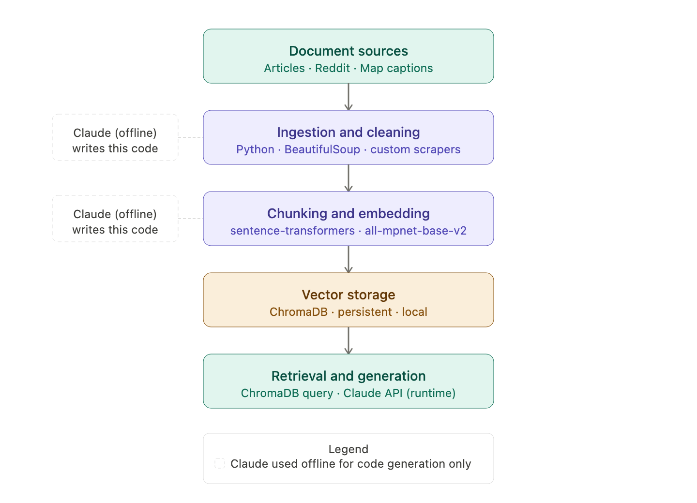

# Project 1 Planning: The Unofficial Guide

> Write this document before you write any pipeline code.
> Your spec and architecture diagram are what you'll use to direct AI tools (Claude, Copilot, etc.) to generate your implementation — the more specific they are, the more useful the generated code will be.
> Update the Retrieval Approach and Chunking Strategy sections if you change your approach during implementation.
> Update this file before starting any stretch features.

---

## Domain

<!-- What domain did you choose? Why is this knowledge valuable and hard to find through official channels? -->
The domain for my Unofficial Guide is things you wouldn't learn on an official campus tour. 
The domain sits at an interesting intersection — it's part local history, part campus life 
guide, part folklore archive, and part nature and art tour. Users might approach it from 
very different angles: a curious freshman, a prospective student, a visiting parent, or even
 a longtime Buff who thinks they know everything. 

This knowledge is valuable because it allows a student to fully immerse in the uniqueness of 
the Historic University of Colorado Boulder campus. Resources are scatterd across newspaper 
articles, campus webpages, reddit forums. This unoffical guide brings together traditions, 
tucked-away study spots, and overlooked museums that define life at one of the most 
architecturally striking campuses in the country — set against the backdrop of the Flatirons 
and Boulder's outdoor culture.
The campus celebrated 150 years which prompted me to consider all the stories, secrets, 
adventure and art that remain within the walls,waiting for a student to uncover it. 

---

## Documents

<!-- List your specific sources: URLs, subreddit names, forum threads, or file descriptions.
     Aim for at least 10 sources that together cover different subtopics or perspectives within your domain. -->

| # | Source | Type | URL or file path |
|---|--------|------|-----------------|
| 1 | CU Independent Newsletter| Article |https://cuindependent.com/2007/01/28/history-behind-the-name-cus-famous-monikers/ |
| 2 | HerCampus| Article | https://www.hercampus.com/school/cu-boulder/hidden-gems-to-study-at-cu-boulder/ |
| 3 | AboutBoulder | Article |https://aboutboulder.com/blog/exploring-the-hidden-gems-university-of-colorados-top-off-the-beaten-path-attractions/ |
| 4 | Cu Boulder Student Life | Website with Links| https://www.colorado.edu/today/2020/01/30/your-guide-campus-venues-museums-and-more |
| 5 | Visit Boulder | List and Map |  https://www.bouldercoloradousa.com/things-to-do/visiting-cu/things-to-do-at-cu/ |
| 6 | Coloradan Alumni Magazine | Website | https://colorado.edu/coloradan/2021/01/21/10-plants-and-animals-spot-campus |
| 7 | Cu Independent |Article | https://www.cuindependent.com/2013/10/24/secret-tunnels-and-murder-the-not-so-scary-truth/|
| 8 | Coloradan Alumni Magazine | Article |https://www.colorado.edu/coloradan/2010/09/01/unlocking-cu-secrets |
| 9 | BASIN | Text | https://bcn.boulder.co.us/basin/watershed/geology/historic.html
| 10 | Daily Camera | Newspaper | https://www.dailycamera.com/2009/08/13/cu-student-murdered-40-years-ago-honored/|
| 11 | About Boulder | Website | https://aboutboulder.com/blog/old-main-at-cu-boulder-history-flatirons-views-fun-facts/ |
| 12 | Reddit | Forum Thread | https://www.reddit.com/r/whatisit/comments/1rwtvbg/comment/ob2cvjy/ |
| 13 | Reddit | Forum Thread | https://www.reddit.com/r/cuboulder/comments/w0ylxm/what_are_some_good_hidden_places_or_resource/ |
| 14 |  Reddit | Forum Thread | https://www.reddit.com/r/whatisit/comments/1rwtvbg/comment/ob2cvjy/ |
| 15 |  Reddit | Forum Thread | https://www.reddit.com/r/cuboulder/comments/1stfz3m/whats_a_free_thing_to_do_in_boulder_that_most_cu/ |
| 16 | CU Independent | BLOCKED Article | https://www.cuindependent.com/2016/02/05/the-story-behind-the-naming-of-the-dalton-trumbo-fountain/ |
| 17 | CU Campus Master Plan| Article | https://www.colorado.edu/masterplan/history/klauder-years-1918-1939 |
| 18 | CU 150th Anniversary | Article | https://www.colorado.edu/150/cu-boulder-student-life-through-decades | 
| 19 | CU Alumni Association | Article | https://www.colorado.edu/alumni/2026/04/15/top-10-cu-boulder-traditions-bring-buffs-together |
---

## Chunking Strategy

<!-- How will you split documents into chunks?
     State your chunk size (in tokens or characters), overlap size, and explain why those
     numbers fit the structure of your documents.
     A review-heavy corpus warrants different chunking than a long FAQ. -->

For newspaper articles and webpages, I will use a chunk size of **300 tokens** with a **75-token overlap**. These documents are typically focused on a single subject. At 300 tokens, each chunk should capture one complete idea without pulling in unrelated content. The 75-token overlap ensures that sentences straddling a boundary remain retrievable from either side.

For Reddit comments and short student-written posts, I will use a chunk size of **150 tokens** with a **30-token overlap**. These sources are already compact and conversational. Larger chunks would group unrelated tips or comments together and reduce retrieval precision.

For map captions and single-line entries, I will keep each entry as **one chunk with no splitting**, typically 30–80 tokens. These inputs are already self-contained units of meaning. Instead of overlap, I will attach structured metadata — including place name, source URL, and category — so retrieval has enough signal to surface them correctly.

---

| Document type | Chunk size | Overlap | Splitting |
|---|---|---|---|
| Articles and webpages | 300 tokens | 75 tokens | Yes |
| Reddit / short posts | 150 tokens | 30 tokens | Yes |
| Map captions | 30–80 tokens | None | No |

---

## Retrieval Approach

<!-- Which embedding model are you using (e.g., all-MiniLM-L6-v2 via sentence-transformers)?
     How many chunks will you retrieve per query (top-k)?
     If you were deploying this for real users and cost wasn't a constraint, what tradeoffs
     would you weigh in choosing a different embedding model — context length, multilingual
     support, accuracy on domain-specific text, latency? -->

**Embedding model:**

THe model that I would use is all-mpnet-base-v2 via sentence-transformer. The all-MiniLM-L6-v2, 
while popular, limits chunk size to 256 chars which is is not effective for the longer chunks 
required for the article and webpage artifacts. This model also eliminates the silent truncation 
that would happen with with the all-MiniLM-L6-v2 model. Choosing all-mpnet-base-v2 will still 
be very fast and free without requiring an API key. If I wasn't limitedby cost, the 
multi-qa-mpnet-base-dot-v1 is a defensible upgrade given because this RAG is question-answering 
system.

**Top-k:**

The embedding model will use a single retrieval call instead of per-type routing. For the corpus
as a while, k=5 should be a solid option. 

**Production tradeoff reflection:**

If I wasn't limitedby cost, the multi-qa-mpnet-base-dot-v1 is a defensible upgrade given because 
this RAG I'm building is a question-answering system. That library has been trained on a wider 
range of inputs and better supports natural language inputs than the all-mpnet-base-v2 is strong
with keyword input so I will try to support the model with an increased number of source files to 
not have to pay for the upgraded library. 
If the retrieval call proves to be unsuccessful with the set k size, I will have update the retrieval
program to per-type routing. 

---

## Evaluation Plan

<!-- List your 5 test questions with their expected correct answers.
     Questions should be specific enough that you can judge whether the system's response
     is right or wrong. "What are good dining halls?" is too vague.
     "What do students say about wait times at [dining hall name] during lunch?" is testable. -->

| # | Question | Expected answer | Question Strength |
|---|----------|-----------------|-------------------|
| 1 |  What is the history behind the Dalton Trumbo Fountain?| The fountain was built in 1964 and rededicated in 1993 to honor CU alum Dalton Trumbo, a Hollywood screenwriter who was blacklisted during the McCarthy era. Kirk Douglas helped break the blacklist by crediting Trumbo for Spartacus. The fountain is a free speech gathering space in front of the UMC. | Tests whether the model can retrieve a specific named landmark with layered historical context across multiple source documents. |
| 2 | Was there a murder in Macky Auditiorium? | In 1966, music student Elaura Jaquette was murdered by janitor Joseph Dyre Morse in room 304. Students have reported hearing phantom organ music despite the organ being removed. There is a memorial plaque for her in the Norlin Quadrangle. | Tests retrieval across multiple sources that cover the same topic — a good stress test for deduplication and chunk quality. |
| 3 | What wildlife can you spot on campus? |  Raccoons, deer, squirrels, beavers, prairie dogs, hawks, foxes, coyotes, and occasional bears (notably during fall move-in 2019). Turtles can be seen at Varsity Lake and Kittredge ponds. The campus also has a 10,000 sq ft pollinator garden with lavender and wildflowers. | Tests retrieval from shorter, list-style content and nature-focused sources rather than narrative articles. |
| 4 | What are some lesser-known study spots that aren't Norlin Library? | UMC 5th floor lounge (Flatirons views), Environmental Design Building, Duane Physics top floor, BioLounge in the Museum of Natural History, Koenig Alumni Center living room, Gemmill Library, and the Mindfulness room on Norlin's first floor. | Tests aggregation across multiple short sources — Reddit comments, Her Campus, CU Today lists — where the answer is spread across several chunks. |
| 5 | What is the origin story of Varsity Lake? | Before 1888, the area was a muddy ravine channeling snowmelt. In 1880 the student newspaper predicted a lake could be built there cheaply. A dam was built in 1888 forming Varsity Lake. Water lilies were recently reintroduced by a campus landscape architect inspired by old photos. | Tests retrieval of specific historical facts from a single focused source — a good check that your article chunking preserved narrative continuity rather than fragmenting the story. |

---

## Anticipated Challenges

<!-- What could go wrong? Name at least two specific risks with reasoning.
     Consider: noisy or inconsistent documents, missing source attribution, off-topic
     retrieval, chunks that split key information across boundaries. -->

1. The document type are different and using a consistent top-k size may be a risk 
for retrieval. This coudld lead to chunks being too long or containing multiple 
ideas if the original comment is short. It will also be important that all sources are
attributed to allow the user to review and verify all provided responses. 

2. There may be an insufficient number of source files to answer every query. It will 
be important to have a response that indicates that an answer couldn't be found instead
of making up one. It could be helpful for the Claude API to provide that an exact answer 
couldn't be found but that another fact (most closely related) may be beneficial to the
user. Don't make up something that isn't within the source documents. 

---

## Architecture

<!-- Draw a diagram of your pipeline showing the five stages:
     Document Ingestion → Chunking → Embedding + Vector Store → Retrieval → Generation
     Label each stage with the tool or library you're using.
     You can use ASCII art, a Mermaid diagram, or embed a sketch as an image.
     You'll use this diagram as context when prompting AI tools to implement each stage. -->

---

## AI Tool Plan

<!-- For each part of the pipeline below, describe:
     - Which AI tool you plan to use (Claude, Copilot, ChatGPT, etc.)
          - Code generation -> Claude (offline)
          - Runtime generation -> Claude API (claude-sonnet-4-6)
          - Retrieval Orchestra -> plain Python

     - What you'll give it as input (which sections of this planning.md, which requirements)
          - Chunking spec
          - all-mpnet-base-v2 embedding model
          - metadatabase schema (source_type, url, place_name, category)
          - top-k value k = 5 (will update per source if necessary)
          - ChromaDB setup
          - eval questions

     - What you expect it to produce
          - For ingestion/chunking stage: a script that reads source documents, cleans HTML
          boilerplate, applies chunking, embeds with all-mpnet-L6-v2, and stores in ChromaDB
          with metadata. 
          - For retrieval stage: a fuction that takes in query string, embeds it, queries
          ChromaDB with top-k and returns ranked chunks AND a generation wrapper that passes 
          retrieved chunks to the Claude API and returns an answer

     - How you'll verify the output matches your spec
          - Run the five eval questions and inpect which chunks came back, not just final
          answer
          - Check that chunk sizes in ChromaDB match spec numbers
          - Confirm metadata fields are present on retrieved chunks
          - spot-check that article chunks aren't truncated mid-sentence

     "I'll use AI to help me code" is not a plan.
     "I'll give Claude my Chunking Strategy section and ask it to implement chunk_text()
     with my specified chunk size and overlap" is a plan. -->

**Milestone 3 — Ingestion and chunking:**

- **AI tool:** Claude (offline, code generation)
- **Input provided:** Full planning.md including the Documents table, Chunking Strategy 
  section (chunk sizes and overlap per source type), metadata schema (source_type, url, 
  place_name, category), and ChromaDB setup requirements
- **Expected output:** A script (ingest.py) that fetches each source URL, cleans HTML 
  boilerplate, detects source type, applies the correct chunking parameters, embeds with 
  all-mpnet-base-v2, and stores chunks in ChromaDB with full metadata including 
  chunk_index and total_chunks_in_source
- **Verification:** Ran the built-in verify_store() function to confirm chunk counts, 
  average token sizes per source type against spec targets, and spot-checked that metadata 
  fields were present on retrieved chunks. Identified that only 39 chunks were stored — 
  investigated whether the issue was chunk size or source count, determined it was blocked 
  sources and insufficient source volume, added 4 additional article sources to reach 95 
  chunks, and implemented an inline_text fallback pattern for JS-rendered and 403-blocked 
  sources (Visit Boulder, CU Independent, Reddit threads)

**Milestone 4 — Embedding and retrieval:**

- **AI tool:** Claude (offline, code generation); plain Python for retrieval orchestration
- **Input provided:** Retrieval Approach section specifying all-mpnet-base-v2, top-k = 5, 
  and the five evaluation questions with expected answers from the Evaluation Plan section
- **Expected output:** A script (retrieve.py) with a retrieve() function that accepts a 
  query string, embeds it using the same model as ingest.py, queries ChromaDB with top-k, 
  and returns ranked chunks with source metadata and distance scores
- **Verification:** Ran all three tested eval queries and inspected returned chunk text, 
  not just distances. Identified that distances above 0.5 and off-topic chunks indicated 
  a model mismatch rather than a chunking problem. Confirmed the root cause by checking 
  what was actually stored for the Trumbo source using a targeted debug query. Upgraded 
  embedding model to multi-qa-mpnet-base-dot-v1 and updated the ChromaDB distance metric 
  from cosine to inner product (ip) accordingly. Re-ingested and re-ran eval queries to 
  confirm improvement. Updated the Macky Auditorium eval query from "What ghost story is 
  associated with Macky Auditorium?" to "Is Macky Auditorium haunted?" and Varsity Lake 
  from "What is the origin story of Varsity Lake?" to "Tell me about Varsity Lake" to 
  better reflect natural user language without teaching to the test

**Milestone 5 — Generation and interface:**

- **AI tool:** Claude (offline, code generation); Groq API with llama-3.3-70b-versatile 
  at runtime
- **Input provided:** Retrieval Approach section, the Gradio skeleton provided in the 
  assignment, requirement to use Groq with llama-3.3-70b-versatile initialized via 
  python-dotenv, prompt template requirement to answer from context only with a fallback 
  response when sources are insufficient, and source attribution requirement
- **Expected output:** Three files — query.py containing the prompt template and 
  end-to-end pipeline function ask(), app.py wiring the Gradio UI to ask() with the 
  model and ChromaDB collection loaded once at startup, and .env.example documenting 
  required environment variables. Source attribution rendered as clickable links in the 
  interface
- **Verification:** Ran python query.py with eval questions from the command line to 
  confirm grounded answers before launching the UI. Confirmed that answers stayed within 
  retrieved context and that the fallback message appeared for out-of-scope questions. 
  Verified source links opened correct URLs in the browser
